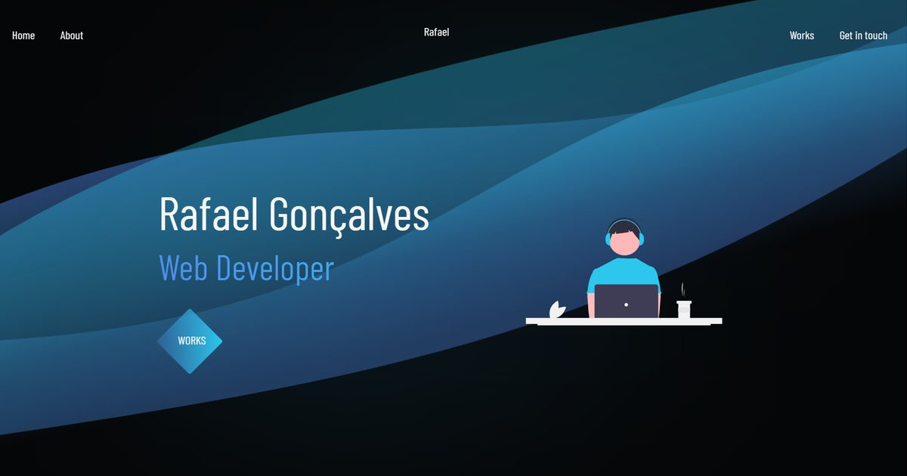

<h1 align="center">Rafael Gonçalves — Portfólio</h1>

<h3 align="center">
    
</h3>

<p align="center">
    <a href="https://rafaelgoncalves.vercel.app">Acessar a demonstração</a>
</p>

---

## 🚀 Tecnologias utilizadas

Site estático, sem framework e sem runtime de build no cliente:

- HTML5
- [Sass](https://sass-lang.com) — compilado para `css/style.css`
- JavaScript (ES6+), sem dependências
- [GSAP](https://greensock.com/gsap/) — animação de entrada do hero, via CDN

---

## 🗂 Como rodar o projeto

```bash
# Clonar o repositório
$ git clone https://github.com/DevRafael-GL/rafael-portifolio.git

# Entrar no diretório
$ cd rafael-portifolio

# Instalar as dependências (apenas o compilador Sass)
$ npm install
```

O `index.html` abre direto no navegador, mas prefira servir por HTTP para que
os caminhos relativos e o `fetch` de fontes funcionem como em produção:

```bash
$ npm start
```

---

## 🎨 Estilos

**O CSS é gerado — nunca edite `css/style.css` à mão.** A fonte da verdade é
`css/style.scss` e os parciais em `css/sass/`.

```bash
# Compilar uma vez
$ npm run build

# Recompilar a cada alteração
$ npm run watch
```

```
css/
├── style.scss          # entrada: importa os parciais
├── style.css           # GERADO — não editar
└── sass/
    ├── _colors.scss        # paleta
    ├── _typography.scss    # escala tipográfica e corpo de texto
    ├── _spacing.scss       # utilitários de margin/padding
    └── _layout.scss        # componentes e media queries
```

---

## 🖼 Imagens

As imagens servidas são `.webp` dimensionadas a 2× do tamanho de exibição.
Os arquivos originais em alta resolução (`Eu.png`, `Foto-1.jpeg`,
`weather-analytics.png`, `Marvel-app.png`, `podcastr-project.jpg`) ficam no
repositório como masters para reexportação — eles **não** são carregados pela
página.

---

Desenvolvido 💜 por Rafael Gonçalves Lima
